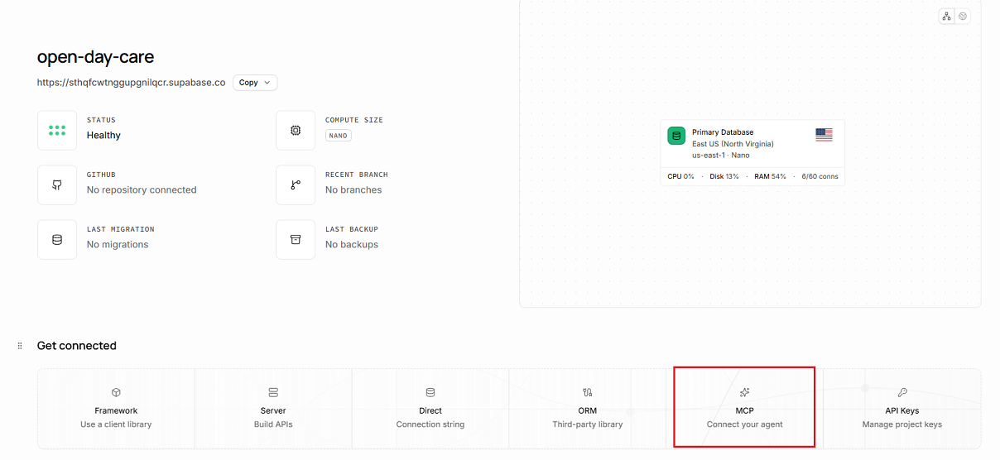
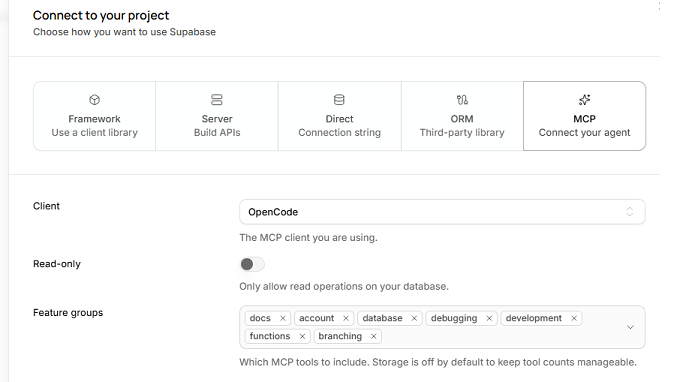

# Supabase

## MCP

Permite conectarse mediante un `MCP`, para esto una vez creado el proyecto ir al dashboard, buscar `Get Connected` y seleccionar `MCP`.


Configurar el `MCP`



Seguir los paso de `Follow these steps`, copiar el script del mcp en el archivo `opencode.jsonc`.

```json
{
  "$schema": "https://opencode.ai/config.json",
  "mcp": {
    "supabase": {
      "type": "remote",
      "url": "https://mcp.supabase.com/mcp?project_ref=sthqfcwtnggupgnilqcr&features=docs%2Caccount%2Cdatabase%2Cdebugging%2Cdevelopment%2Cfunctions%2Cbranching",
      "enabled": true
    }
  }
}
```

**NOTA**: También se puede pegar el script de conexión del `MCP` de `Supabase` en la consola de `OpenCode` y ejecutará el proceso de forma automática

Ejecutar:

- Autentificar `Supabase`:

```powershell
opencode mcp auth supabase
```

- Skills

```powershell
npx skills add supabase/agent-skills
```
