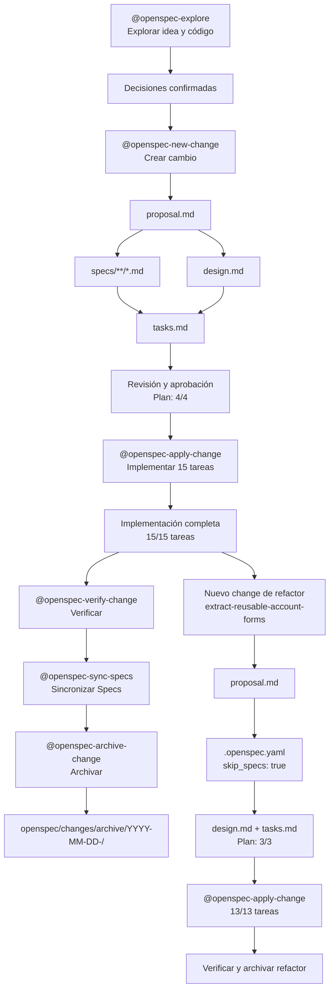

# OpenSpec: guía de consulta rápida

OpenSpec es un framework para definir, revisar, implementar y conservar especificaciones de software junto con un asistente de código como OpenCode.

Fuentes oficiales: [OpenSpec](https://openspec.dev/) · [Getting Started](https://github.com/Fission-AI/OpenSpec/blob/main/docs/getting-started.md) · [Personalización](https://github.com/Fission-AI/OpenSpec/blob/main/docs/customization.md)

## 1. Instalar y verificar

Instala OpenSpec globalmente y comprueba la versión:

```bash
npm install -g @fission-ai/openspec@latest
openspec --version
```

Ejemplo de salida:

```text
2.1.0
```

## 2. Inicializar el proyecto

Ejecuta la inicialización desde la raíz del proyecto:

```bash
cd tu-proyecto
openspec init
```

La inicialización crea la carpeta `openspec/`, sus directorios de trabajo y `config.yaml`.

## 3. Entender la estructura inicial

```text
openspec/
├── changes/
│   ├── archive/
│   │   └── .gitkeep
│   └── .gitkeep
├── specs/
│   └── .gitkeep
└── config.yaml
```

| Elemento | Función |
| --- | --- |
| `changes/` | Cambios que están siendo propuestos, revisados o implementados. Cada cambio tiene una carpeta propia. |
| `changes/archive/` | Historial de cambios terminados. `@openspec-archive-change` mueve allí el cambio completado. |
| `specs/` | Specs principales: fuente de verdad del comportamiento actual del sistema, organizadas por dominio. |
| `.gitkeep` | Archivo vacío que permite a Git conservar una carpeta que todavía no tiene archivos reales. No contiene configuración. |
| `config.yaml` | Configuración del proyecto: esquema predeterminado, contexto, reglas e indicaciones de operaciones. |

Cuando se crea un cambio, su estructura habitual es:

```text
openspec/changes/<nombre-del-cambio>/
├── proposal.md
├── specs/<dominio>/spec.md
├── design.md
└── tasks.md
```

## 4. Skills instaladas para OpenCode

En la instalación utilizada, `openspec init --tools opencode` creó las Skills seleccionadas en:

```text
C:\Users\Developer\.agents\skills\
├── openspec-apply-change\
├── openspec-archive-change\
├── openspec-explore\
├── openspec-new-change\
├── openspec-propose\
├── openspec-sync-specs\
├── openspec-update-change\
└── openspec-verify-change\
```

Cada directorio contiene las instrucciones que OpenCode utiliza para ejecutar una parte del flujo de OpenSpec:

| Skill | Función |
| --- | --- |
| `openspec-explore` | Explorar una idea, investigar el código y aclarar el problema sin implementar cambios. |
| `openspec-new-change` | Crear la estructura inicial de un cambio para trabajarlo paso a paso. |
| `openspec-propose` | Crear una propuesta completa con `proposal.md`, Specs delta, `design.md` y `tasks.md`. |
| `openspec-apply-change` | Implementar las tareas definidas en un cambio aprobado. |
| `openspec-update-change` | Revisar y mantener coherentes los artefactos de planificación de un cambio. |
| `openspec-sync-specs` | Sincronizar las Specs delta con las Specs principales. |
| `openspec-archive-change` | Cerrar y archivar un cambio completado, conservando su historial. |
| `openspec-verify-change` | Comprobar que la implementación coincide con los artefactos del cambio antes de archivarlo. |

Se invocan desde el chat de OpenCode con los nombres que reconoce la instalación:

```text
@openspec-explore
@openspec-new-change
@openspec-propose "crear preferencias de usuario"
@openspec-apply-change
@openspec-update-change
@openspec-sync-specs
@openspec-archive-change
@openspec-verify-change
```

> **Aclaración sobre la invocación:** en este entorno las Skills de OpenSpec se llaman con el prefijo `@`, por ejemplo `@openspec-propose`. Algunas versiones o herramientas muestran la misma integración con `/openspec-*`, `/opsx-*` u otra sintaxis. Debes utilizar el formato que aparezca en el autocompletado de tu asistente.

### ¿Por qué están fuera del proyecto?

Estas Skills se crearon en `C:\Users\Developer\.agents\skills\` porque la configuración seleccionada utiliza una ubicación global del usuario. La ruta `~/.agents/skills/` permite que las mismas instrucciones estén disponibles en todos los proyectos sin duplicarlas en cada repositorio.

Por tanto:

- `openspec/` dentro del proyecto contiene las Specs, los cambios y la configuración específica del proyecto.
- `~/.agents/skills/` contiene las instrucciones reutilizables de OpenSpec para el usuario.
- Las Skills globales no contienen los requisitos ni el código del proyecto.
- El mismo conjunto de Skills puede trabajar sobre distintos proyectos, utilizando el `openspec/` que encuentre en la carpeta activa.

Esta ubicación es válida y no indica un error de instalación. El curso puede mostrar archivos dentro de `.opencode/commands/` porque utiliza una configuración basada en comandos locales. La instalación actual usa Skills globales y por eso no crea esos archivos.

### Configurar las Skills disponibles

Las Skills no se seleccionan instalando cada directorio manualmente. OpenSpec permite configurar los workflows disponibles mediante:

```powershell
openspec config profile
```

En el menú se selecciona **Workflows only** y se marcan los workflows deseados con la tecla **Espacio**. Después se confirma con **Enter** y se regeneran las Skills mediante:

```powershell
openspec update --force
```

En este proyecto se configuró un perfil personalizado (`custom`) con los siguientes workflows activos:

- **Propose change** → `openspec-propose`
- **Explore ideas** → `openspec-explore`
- **New change** → `openspec-new-change`
- **Apply tasks** → `openspec-apply-change`
- **Update change** → `openspec-update-change`
- **Sync specs** → `openspec-sync-specs`
- **Archive change** → `openspec-archive-change`
- **Verify change** → `openspec-verify-change`

Los workflows no seleccionados —`Continue change`, `Fast-forward`, `Bulk archive` y `Onboard`— no generan sus Skills hasta que se activen en el perfil y se ejecute nuevamente `openspec update --force`.

### No confundir con los comandos de SDD

En este proyecto, la carpeta `.opencode/commands/` contiene actualmente:

```text
.opencode/
└── commands/
    ├── spec-acceptance-validator.md
    └── spec-impl.md
```

Estos archivos corresponden al flujo de **Spec Driven Development (SDD)** y no son comandos de OpenSpec. OpenSpec utiliza las Skills `openspec-*` instaladas en `C:\Users\Developer\.agents\skills\`.

Por eso ambas ubicaciones pueden coexistir:

| Ubicación | Contenido | Propósito |
| --- | --- | --- |
| `.opencode/commands/` | `spec-acceptance-validator.md`, `spec-impl.md` | Comandos locales de SDD del proyecto. |
| `C:\Users\Developer\.agents\skills\` | Directorios `openspec-*` | Skills globales de OpenSpec disponibles para todos los proyectos. |

La ausencia de `opsx-*.md` en `.opencode/commands/` no significa que OpenSpec no esté instalado. Significa que esta instalación está utilizando el formato de Skills globales en lugar de generar comandos `opsx-*` locales.

## 5. Configurar `config.yaml`

`openspec/config.yaml` se versiona junto con el proyecto. Puede definir:

- `schema`: esquema de trabajo predeterminado.
- `context`: stack tecnológico, convenciones y restricciones que conocerá el asistente.
- `rules`: reglas para artefactos como `proposal` y `specs`.
- `operations.apply.guidance`: indicaciones para implementar.
- `operations.archive.guidance`: indicaciones para archivar.

Ejemplo mínimo:

```yaml
schema: spec-driven

context: |
  Stack: TypeScript, React y PostgreSQL
  Tests: Vitest

rules:
  proposal:
    - Incluir alcance y plan de rollback
  specs:
    - Usar escenarios Given/When/Then
```

Consulta la [documentación de personalización](https://github.com/Fission-AI/OpenSpec/blob/main/docs/customization.md) antes de añadir opciones nuevas.

### Configurar el contexto mediante un prompt

También puedes pedirle a OpenCode que documente el objetivo del proyecto directamente en el archivo de configuración. Utiliza `config.yaml` —no `config.yml`— y referencia el archivo con `@`:

```text
Explica a OpenSpec en el archivo @openspec/config.yaml el objetivo de este proyecto.
Revisa el código y la documentación existente para describir su propósito, stack tecnológico,
arquitectura, convenciones importantes, comandos de pruebas y restricciones.
Modifica únicamente openspec/config.yaml y no inventes información que no pueda verificarse.
```

OpenCode puede completar el campo `context` con información que OpenSpec inyectará en las instrucciones de sus Skills. Ese contexto ayuda a que las propuestas, Specs, diseños y tareas respeten el proyecto existente.

Un resultado esperado puede tener esta forma:

```yaml
schema: spec-driven

context: |
  Objetivo: plataforma para gestionar el cuidado y la comunicación de una guardería.
  Stack: Next.js, TypeScript, PostgreSQL y Tailwind CSS.
  Arquitectura: aplicación web con autenticación y acciones del servidor.
  Pruebas: ejecutar npm test antes de integrar cambios.
  Restricciones: respetar los patrones existentes y no modificar datos de producción.
```

Después de aceptar el cambio, revisa el archivo y el diff antes de continuar. El prompt debe modificar solamente la configuración del proyecto; no debe generar Specs, implementar código ni reemplazar las reglas ya existentes sin confirmación.

## 6. Dónde se ejecuta cada comando

| Contexto | Comandos | Uso |
| --- | --- | --- |
| Terminal | `openspec ...` | Inicializar, consultar y validar el proyecto. |
| Chat de OpenCode | `@openspec-*` | Explorar, proponer, implementar, sincronizar y archivar cambios mediante Skills. |

No es necesario iniciar un modo interactivo separado.

## 7. Términos esenciales

| Término | Significado |
| --- | --- |
| **Spec** | Documento que describe el comportamiento que el sistema debe cumplir. |
| **Spec principal** | Spec estable almacenada en `openspec/specs/`. |
| **Spec delta** | Requisitos de un cambio: `ADDED`, `MODIFIED` o `REMOVED`. |
| **Change** | Carpeta de trabajo en `openspec/changes/<nombre>/`. |
| **Proposal** | Explica por qué se necesita el cambio, su alcance y enfoque. |
| **Design** | Describe cómo se resolverá técnicamente. |
| **Tasks** | Lista ordenada de tareas de implementación. |
| **Archive** | Proceso que cierra un cambio y conserva sus artefactos en `changes/archive/`. |
| **Schema** | Flujo que define los artefactos, sus plantillas y dependencias. |

Tipos de requisitos delta:

- `ADDED`: añade comportamiento nuevo.
- `MODIFIED`: cambia un requisito existente.
- `REMOVED`: elimina un requisito obsoleto.

## 8. Flujo secuencial de trabajo

### 8.1. Explorar — opcional

En el chat de OpenCode:

```text
@openspec-explore
```

Úsalo cuando la idea todavía no está clara. Lee el contexto, compara alternativas y ayuda a definir el problema sin implementar código.

Si hace falta una entrevista más exhaustiva, puede utilizarse `@grilling` antes de OpenSpec:

```text
@grilling
```

`grilling` descubre requisitos; OpenSpec los convierte en artefactos gestionables.

### 8.2. Proponer

En el chat de OpenCode:

```text
@openspec-propose "nombre-del-cambio"
```

OpenSpec genera `proposal.md`, Specs delta, `design.md` y `tasks.md` según el esquema activo.

### 8.3. Revisar

Antes de implementar, verifica que la propuesta tenga:

- alcance y objetivo claros;
- requisitos verificables y escenarios;
- decisiones técnicas justificadas;
- tareas ordenadas;
- riesgos y elementos fuera de alcance.

### 8.4. Implementar

Cuando la propuesta esté aprobada, en el chat:

```text
@openspec-apply-change
```

El asistente ejecuta las tareas y actualiza los artefactos si aparecen nuevas decisiones. No uses `apply` antes de revisar el plan.

### 8.5. Sincronizar y archivar

Al terminar la implementación:

```text
@openspec-sync-specs
@openspec-archive-change
```

`sync` incorpora los requisitos aceptados en las Specs principales. `archive` cierra el cambio y lo mueve a `changes/archive/` para conservar su historial.

### 8.6. Comandos y parámetros utilizados en los ejemplos

Estos son los comandos ejecutados durante los flujos documentados. Los comandos de terminal se ejecutan desde la raíz del proyecto; las Skills se escriben en el chat de OpenCode.

#### Preparación del proyecto

```powershell
# Instalar y verificar OpenSpec
npm install -g @fission-ai/openspec@latest
openspec --version

# Inicializar y configurar OpenCode como herramienta
openspec init --tools opencode

# Configurar workflows disponibles
openspec config profile

# Regenerar las Skills según el perfil seleccionado
openspec update --force
```

En `openspec config profile` se eligió **Workflows only** y se activaron `propose`, `explore`, `new`, `apply`, `update`, `sync`, `archive` y `verify`. El parámetro `--force` obliga a regenerar las Skills aunque OpenSpec considere que ya están actualizadas.

#### Cambio de funcionalidad: `add-staff-account-page`

```text
# Explorar el problema y descubrir requisitos
@openspec-explore <prompt-con-la-idea>

# Crear un cambio nuevo
@openspec-new-change

# Continuar con la propuesta creada
Continua

# Completar los artefactos que faltaban
Continúa y completa la planificación de add-staff-account-page.

NOTA IMPORTANTE: esto debido a que no se crearon los artefactos:
1. Especificación staff-account
2. design.md
3. tasks.md

# Implementar el cambio usando su identificador
@openspec-apply-change add-staff-account-page
```

El identificador `add-staff-account-page` es el parámetro que vincula las Skills con `openspec/changes/add-staff-account-page/`. En este flujo se generaron cuatro artefactos y se completaron 15 tareas.

#### Consultar el estado del proyecto

```powershell
# Dashboard resumido
openspec view

# Listar cambios
openspec list --changes

# Listar Specs principales
openspec list --specs
```

#### Refactor sin cambios funcionales: `extract-reusable-account-forms`

```text
# Crear un cambio independiente para el refactor
@openspec-new-change

# Crear la propuesta
Continua con la propuesta

# Omitir Specs delta porque no cambia el comportamiento
Configura skip_specs: true

# Completar design.md y tasks.md
Continua con la planificación

# Implementar el refactor usando su identificador
@openspec-apply-change extract-reusable-account-forms
```

`skip_specs: true` no es un parámetro de `@openspec-apply-change`. Es una configuración del cambio que OpenSpec guarda en `openspec/changes/extract-reusable-account-forms/.openspec.yaml`. En este caso se generaron tres artefactos (`proposal.md`, `design.md` y `tasks.md`) y se completaron 13 tareas.

Los prompts y las respuestas completas se conservan en [Flujo de cuenta de personal](./ejemplos/01-cuenta-personal-plan.md) y [Refactor de formularios reutilizables](./ejemplos/02-refactor-formularios-reutilizables.md).

#### Verificar un cambio

Después de implementar todas las tareas, ejecuta la Skill de verificación desde el chat de OpenCode:

```text
@openspec-verify-change add-staff-account-page
```

También puedes verificar el refactor:

```text
@openspec-verify-change extract-reusable-account-forms
```

El nombre del cambio es un parámetro opcional pero recomendable. Permite verificar directamente una carpeta concreta dentro de `openspec/changes/`. Si se omite y existe un único cambio activo, OpenSpec puede inferirlo; si hay varios cambios o el contexto es ambiguo, solicitará que se seleccione uno. El parámetro es el **identificador del change**, no la ruta ni el nombre de un archivo `spec.md`; la Skill carga automáticamente los artefactos asociados (`proposal.md`, Specs, `design.md` y `tasks.md`).

La verificación es de solo lectura: revisa estado, artefactos, tareas, requisitos —cuando existan—, diseño, implementación y comprobaciones técnicas. No modifica archivos ni archiva el cambio.

La invocación correcta es `@openspec-verify-change`, con `change` completo. `@openspec-verify-chang` es un error de escritura y no corresponde a una Skill instalada.

#### Archivar un cambio

Después de revisar y verificar el cambio, se archiva indicando nuevamente su identificador:

```text
@openspec-archive-change add-staff-account-page
@openspec-archive-change extract-reusable-account-forms
```

El archivado mueve cada cambio a `openspec/changes/archive/` con la fecha y sincroniza sus Specs delta. Para un cambio con `skip_specs: true`, no existe delta que sincronizar.

## 9. Comandos de consulta y validación

Estos comandos se ejecutan en la terminal:

```bash
# Listar cambios activos
openspec list

# Mostrar un cambio
openspec show nombre-del-cambio

# Validar un cambio
openspec validate nombre-del-cambio

# Abrir el panel interactivo
openspec view
```

La validación complementa la revisión humana y los tests del proyecto; no los sustituye.

### Ejemplo de `openspec view`

Desde la raíz del proyecto, `openspec view` muestra un resumen del estado de las Specs y los cambios:

```text
OpenSpec Dashboard

Summary:
  ● Specifications: 0 specs, 0 requirements
  ● Draft Changes: 1
  ● Active Changes: 0 in progress
  ● Completed Changes: 0

Draft Changes
  ○ add-staff-account-page
```

Interpretación del resultado:

| Indicador | Significado |
| --- | --- |
| `Specifications` | Cantidad de Specs principales y requisitos registrados en `openspec/specs/`. |
| `Draft Changes` | Cambios creados que todavía están en planificación, como `add-staff-account-page`. |
| `Active Changes` | Cambios cuya implementación está en progreso. |
| `Completed Changes` | Cambios completados y archivados. |
| `0 requirements` | Todavía no existen requisitos en las Specs principales; los requisitos delta pueden estar dentro de un cambio en planificación. |

En este ejemplo hay un cambio creado, pero todavía no hay Specs principales ni cambios implementados. Para consultar el detalle desde la terminal:

```powershell
openspec list --changes
openspec list --specs
```

`openspec view` sirve como vista general; `openspec list` permite consultar las listas detalladas de cambios o Specs.

Cuando los cambios han sido implementados y archivados, el dashboard puede mostrar:

```text
Summary:
  ● Specifications: 0 specs, 0 requirements
  ● Active Changes: 0 in progress
  ● Completed Changes: 2

Completed Changes
  ✓ add-staff-account-page
  ✓ extract-reusable-account-forms
```

`Completed Changes` indica que los cambios ya fueron cerrados y trasladados al historial de `openspec/changes/archive/`.

## 10. Referencia rápida

```text
Terminal: npm install -g @fission-ai/openspec@latest
Terminal: openspec init --tools opencode
Terminal: openspec config profile
Terminal: openspec update --force
Chat:     @openspec-explore             (opcional)
Chat:     @openspec-new-change
Chat:     @openspec-propose "tu idea"
Revisión de proposal, specs, design y tasks
Chat:     @openspec-apply-change
Chat:     @openspec-verify-change "nombre-del-cambio"
Chat:     @openspec-sync-specs
Chat:     @openspec-archive-change "nombre-del-cambio"
Terminal: openspec view
```

Flujo combinado recomendado: `@grilling` → `@openspec-propose` → revisión → `@openspec-apply-change` → `@openspec-sync-specs` → `@openspec-archive-change`.

## 11. Diagrama del flujo

El siguiente diagrama se actualizará conforme se completen nuevas etapas y ejemplos. El flujo muestra la separación entre explorar, crear los artefactos, revisar, implementar, verificar y cerrar el cambio:



### Ejemplos documentados

- [Flujo de cuenta de personal](./ejemplos/01-cuenta-personal-plan.md) — exploración, planificación `4/4`, implementación `15/15`, verificación y archivado de `add-staff-account-page`.
- [Refactor de formularios reutilizables](./ejemplos/02-refactor-formularios-reutilizables.md) — cambio independiente con `skip_specs: true`, planificación `3/3`, implementación `13/13`, verificación y archivado.

El diagrama y los enlaces se ampliarán cuando existan nuevos ejemplos documentados de Specs, diseño, tareas, implementación, verificación y archivado.

---

[← Anterior](../temarios/04-metodologias-de-desarrollo-de-software.md) | [Índice principal](../README.md)
